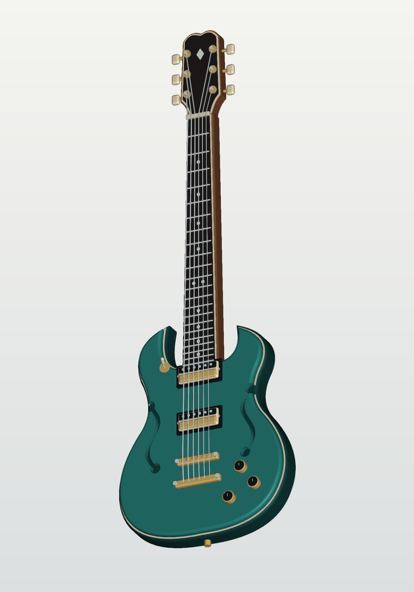

# Agent SDF

<p align="center">
  
  <br>
  <sub><a href="examples/guitar.py"><code>examples/guitar.py</code></a></sub>
</p>

A Python geometry API for building, combining, and inspecting 2D and 3D shapes as signed distance fields. Compose solids, curves, and assemblies in code, then view or render them with WebGL2.

This is designed for an agent to quickly define geometry as a script then render and augment iteratively. One command renders chosen views and prints the scene bounds:

```sh
uv run sdf-render scene.py --view iso front top    # standard views, framed to the scene
uv run sdf-render scene.py --eye 4 -6 3            # custom camera, aimed at the scene center
```

Standard views are `iso`, `front`, `back`, `left`, `right`, and `top`/`bottom`; axis views are orthographic. Several views write a labeled sheet; the adjacent JSON records cameras and component bounds.


## Quick start

Requires Python 3.14 and [uv](https://docs.astral.sh/uv/). PNG rendering also requires Chrome or Chromium; set `SDF_CHROME` to its executable if it is not on your path.

```sh
uv sync
```

Create `scene.py`:

```python
from agent_sdf import box, cylinder, sphere

SCENE = (sphere(0.8) | box(2, 2, 0.4).translate(0, 0, -0.4)) - cylinder(0.25, 2)
```

```sh
uv run sdf-view scene.py
uv run sdf-render scene.py -o render.png --width 512 --height 512
```

The viewer opens a local browser page. The renderer writes a PNG and adjacent camera-settings JSON. Define a 3D `SCENE` as a `Field`, `Part`, `Assembly`, `Instance`, or `Scene`; `MODEL` also accepts a `Part`, `Assembly`, or `Instance`.

## Geometry

Import from `agent_sdf`. Geometry is represented by `Field` objects; distances are negative inside solids. Most primitives are centered at the origin.

World axes are right-handed with Z up. Cameras look along local −Z with local +Y up. Angles are radians, except camera `fov` in degrees; quaternions use `(w, x, y, z)`.

| Operation | API |
| --- | --- |
| 2D primitives | `circle(radius)`, `rectangle(width, height, corner_radius=0)`, `polygon(points)` |
| 3D primitives | `sphere(radius)`, `box(width, depth, height, corner_radius=0)`, `cylinder(radius, height)`, `torus(major_radius, tube_radius)`, `capsule(start, end, radius)` |
| Combine | `a \| b` union, `a & b` intersection, `a - b` difference, `a ^ b` symmetric difference, `a.smooth_union(b, radius)`. Operands must have the same dimension. |
| Transform | `.translate(*offset)`, `.rotate(angle, axis="z")`, `.scale(factor)`, `.transform(Transform(...))`, `.place(Placement(...))` |
| Modify | `.offset(amount)`, `.shell(thickness)`, `.linear_pattern(count, *step)`, `.radial_pattern(count, axis="z")`, `.with_material(id)`, `.named(name)` |
| Make solids | On a 2D field: `.extrude(height, offset=0)`, `.revolve(axis="x")` or `axis="y"`, `.loft([LoftStation(position, offset=(u, v), scale=s), ...])`, `.sweep(curve)`. `field_morph([(position, profile), ...])` blends different profiles. |
| Curves | `Curve(*start).line_to(*end).quad_to(control, end).arc_to(center, end)`. Use `.close()` for a 2D profile or `.tube(radius)` for a 3D tube; 3D arcs require `normal`. |
| Planes | `Plane.xy(z=0)`, `.xz(y=0)`, `.yz(x=0)`, or `Plane(origin, normal, x_direction=...)`. `profile.on(plane)` creates a `Sketch` for extrusion, lofting, or revolution. `AnchorPlane` adds named points: `.define_point(name, point)`, `.point(name, space="world")`. |

Placement, shells, radial patterns, and materials require 3D fields. `Transform` is affine; `Placement` is rigid. Compose either with `.then(other)`.

For custom geometry, use `custom_sdf(fn, dim=3, material_id=0, bounds=..., lipschitz=...)`. The callable receives symbolic coordinates and returns a distance or `Sample(distance, material)`; use `agent_sdf.math` for field-aware math. Supply finite enclosing bounds and a positive Lipschitz bound (`1` for a true SDF). `min_` and `max_` combine fields or symbolic scalars pointwise.

Nonlinear transforms use `Warp(dim, inverse, lipschitz=...)` and `.warp(warp, bounds=...)`. Extrusion height and offset can also be symbolic functions of `(x, y)`; supply finite 3D bounds and `height_lipschitz` / `offset_lipschitz` as needed.

## Assemblies and inspection

Define reusable geometry with `Part(field, material=Material(name, base_color=...), datums=...)`. Place it with `.at(Placement(...))`, then compose with `Assembly().add(name, part_or_instance)` or `Scene(...named_components)`. Assemblies can be nested; `.datum("component/name")` resolves exported points, planes, or placements. `.to_field()` unions the placed fields. See the [assembly example](examples/assembly.py).

Evaluate with `field(*point)` for a `Sample`, `.sdf(*point)` for distance, or `.sample(points)` for distance/material arrays. Inspect with `.bounds()`, `.extents()`, and `.bvh()`.

`ray_cast(...)` and `pick(...)` return a `SurfaceHit` or `None`; `distance_between(a, b)` measures 3D distance. `section(object, plane, bounds)` returns world-space contours; `field.slice(plane).contours(bounds)` returns local 2D contours.

## Rendering

`render(scene, width, height, eye, target, ...)` returns a Pillow image. Use `fov=0, camera_size=2` for orthographic projection.

CLI tools: `sdf-view` and `sdf-render`. Run each with `--help` for options. Both accept `--eye X Y Z`, `--target X Y Z`, `--fov`, and `--bvh/--no-bvh`.

`sdf-render` renders `--view` names, else the scene's `VIEWS`, else `iso`. `VIEWS` maps names to camera dicts (`eye`, `target`, `fov`, `far`, `camera_size`, `up`, `orientation`); `--views FILE` reads the same from JSON or a previous render's metadata. Use `--final` for antialiased output.

Browse the [examples](examples) for complete models.

## License

Copyright ©️ 2026 Ben Kaye. Licensed under the [MIT License](LICENSE).